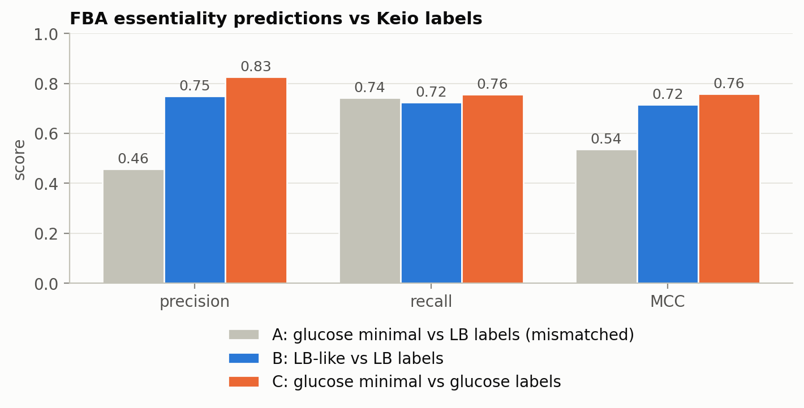

# Predicting essential genes of *E. coli* with a genome-scale metabolic model

How well can a metabolic model predict which genes *E. coli* cannot live without, and where does it go wrong?

This project deletes each of the 1,515 genes of the iML1515 metabolic model in silico, predicts with Flux Balance Analysis (FBA) whether the cell can still grow, and checks the predictions against the Keio collection, the experimental library of single-gene deletion mutants of *E. coli* K-12.

**Result in one table** (1,508 genes with an experimental label; the positive class is "essential"):

| Comparison | Simulated medium | Experimental label | Precision | Recall | MCC | Accuracy |
|---|---|---|---|---|---|---|
| A (mismatched on purpose) | glucose minimal | no deletion mutant on LB | 0.46 | 0.74 | 0.54 | 0.91 |
| B (matched, rich) | LB-like | no deletion mutant on LB | 0.75 | 0.73 | 0.72 | 0.96 |
| C (matched, minimal) | glucose minimal | no mutant on LB, or mutant does not grow in glucose minimal medium | 0.83 | 0.76 | 0.76 | 0.94 |



## Main findings

1. **The growth medium has to match.** The Keio collection calls a gene essential when no deletion mutant could be isolated on LB, a rich medium. Simulating glucose minimal medium and comparing with those labels (comparison A) produces 106 false positives. With matched media the number drops to 29 (B) and 34 (C). Accuracy hardly registers the problem (0.91 against 0.94 to 0.96) because most genes are non-essential either way; precision and MCC show it.
2. **Matched predictions agree with experiment for 94 to 96 % of genes**, with an MCC of 0.72 to 0.76. The model predicts 116 essential genes on LB-like medium and 195 on glucose minimal medium. The 79 additional genes are mostly in amino acid, nucleotide and cofactor biosynthesis.
3. **Some "model errors" are doubtful labels.** For six false positives (*coaA*, *coaE*, *folP*, *glmM*, *hemE*, *lptB*) a later re-examination of the collection found that both isolates of the deletion strain still carry an intact copy of the gene (Yamamoto et al. 2009).
4. **Most remaining false positives are simple auxotrophs in the model.** In comparison C, 22 of 34 can be rescued by adding one nutrient to the simulated medium, for example thiamin for all eight thiamin biosynthesis genes and a sulfur compound for four sulfate assimilation genes.
5. **Most false negatives come from alternatives the model allows.** In comparison C, 17 of 52 have another gene listed for all of their reactions (for example *thrA* with *metL* and *lysC*, *leuB* with *dmlA*), and for the other 35 the model routes flux around the lost reactions.
6. **The calls are robust to the arbitrary choices.** The essentiality threshold (growth below 0.0001 % to 20 % of wild type), the uptake limit of LB nutrients (1 to 100 mmol/gDW/h) and the genotype of the Keio parent strain change none of the calls.

## Why the medium matters

A gene that is only needed to make an amino acid is not essential in rich medium, which supplies the amino acid, but is essential in minimal medium. Both statements are correct, so prediction and label must refer to the same medium.

Baba et al. (2006) provide two kinds of data, which give two labels:

| Label | Definition | Genes in the model |
|---|---|---|
| essential on LB | the gene was targeted and fewer than two colonies carried the correct deletion (the paper's rule; reproduces its 303 candidates exactly) | 120 |
| essential on glucose minimal | essential on LB, or the mutant exists but reaches OD600 < 0.08 after 48 h in glucose MOPS medium (the cut-off of the paper's Table III) | 213 |

LB is made from tryptone and yeast extract and has no defined composition. The simulated "LB-like" medium is the glucose minimal medium plus the compounds of a published in-silico LB definition (CarveMe media database, Machado et al. 2018). It is an approximation, and its absolute growth rate is not realistic because all nutrients can be taken up at once; it is used only for the yes/no question whether a knockout can grow.

## Where the model is wrong

Each mispredicted gene was sorted into an evidence group. The groups describe what the model and the experimental tables show; they are not a verdict on the biological cause.


Four what-if scenarios, each suggested by the literature, were rerun on all genes:

| Scenario | FP | FN | MCC | Errors resolved | New errors |
|---|---|---|---|---|---|
| C baseline (glucose minimal) | 34 | 52 | 0.757 | | |
| C1: add thiamin, biotin, nicotinate, pantothenate | 22 | 65 | 0.746 | 12 | 13 |
| C2: add a sulfonate (taurine) as sulfur source | 30 | 53 | 0.764 | 4 | 1 |
| C3: make reaction GHMT2r irreversible | 34 | 49 | 0.767 | 3 | 0 |
| B baseline (LB-like) | 29 | 33 | 0.715 | | |
| B1: add biotin and L-glutamine | 21 | 36 | 0.728 | 8 | 3 |

What the scenarios show:

- **Thiamin.** All eight thiamin biosynthesis mutants grow in minimal medium although the model needs the pathway. Supplying thiamin resolves all eight and creates no new error among thiamin genes. Bernstein et al. (2023) reported the same pattern in a different data set and proposed carry-over or cross-feeding of vitamins.
- **Biotin is different.** Supplying biotin resolves *bioA* but turns five other biotin genes, which really do fail to grow in the experiment, into new errors. The odd one out is the *bioA* mutant, not the medium.
- **Sulfur.** Four sulfate assimilation mutants (*cysC*, *cysD*, *cysN*, *cysQ*) grow in the experiment. In the model any sulfonate rescues them. The experimental medium is buffered with MOPS, a sulfonate, which Orth & Palsson (2012) mention as a possible alternative sulfur source. MOPS is not part of the model, so this was tested with taurine as a stand-in and remains a hypothesis.
- **Serine.** *serA*, *serB* and *serC* mutants do not grow in minimal medium, but the model makes serine by running the reaction GHMT2r backwards, as described by Bernstein et al. (2023). Making the reaction irreversible resolves all three.

None of the scenarios is adopted as a corrected model. C1 removes twelve false positives and adds thirteen false negatives, so a better-looking precision would hide a worse recall. The baseline numbers above are the result.

## Methods in brief

- **Model:** iML1515 (Monk et al. 2017) from BiGG Models, COBRApy 0.32, GLPK solver. Wild-type growth on aerobic glucose minimal medium is 0.877 h⁻¹.
- **Knockout screen:** every gene is switched off in turn; reactions whose gene-reaction rule can no longer be satisfied are blocked; growth is maximised again. A knockout is called essential when it grows at less than 5 % of the wild-type rate. One placeholder gene for spontaneous reactions (`s0001`) is skipped.
- **Labels:** Supplementary Table 3 of Baba et al. (2006), mapped to the model by b-number. All 1,515 model genes are in the table; seven have no label because they are already deleted or disrupted in the parent strain BW25113.
- **Metrics:** confusion matrix with "essential" as the positive class; precision, recall and the Matthews correlation coefficient are reported next to accuracy because only 8 to 14 % of the scored genes are essential.
- **Error analysis:** for false positives, the biomass components the knockout cannot make and every single nutrient that restores growth; for false negatives, the reactions lost and the genes that can replace the deleted one.

## Repository

```
notebooks/
  01_model_exploration.ipynb   the model, its medium, a first FBA
  02_knockout_screen.ipynb     knockout screen on two media, threshold and uptake sensitivity
  03_keio_validation.ipynb     Keio labels, the three comparisons, robustness checks
  04_error_analysis.ipynb      evidence for every false positive and false negative, scenarios
src/ecoli_fba/                 analysis code used by the notebooks
  model.py  media.py  knockout.py  keio.py  evaluate.py  annotation.py  errors.py  plotting.py
scripts/fetch_keio.py          downloads the Keio tables and verifies their checksums
tests/                         pytest suite
data/                          downloaded inputs (not committed); see data/README.md
results/tables/                every number quoted in this README
results/figures/               figures
```

## Reproduce

```bash
python -m venv .venv
source .venv/bin/activate
pip install -r requirements.txt        # or: conda env create -f environment.yml

python scripts/fetch_keio.py           # Keio tables, about 6 minutes, checksum-verified
jupyter lab                            # run notebooks 01 to 04 in order
```

Notebook 01 downloads the model on first run. Notebooks 02 and 03 take under two minutes each, notebook 04 about six.

Tests:

```bash
pytest            # unit tests, a few seconds
pytest -m slow    # full-model test, about 20 seconds
```

The unit tests use a seven-gene toy model whose essential genes can be worked out by hand, and check the Keio parser against the numbers stated in the paper (4,288 targeted ORFs, 3,985 mutants, 303 essential candidates, identical to the paper's own list).

## Limitations

- FBA assumes a steady state and an optimally growing cell. It knows nothing about gene regulation, enzyme capacity or toxic intermediates, so an alternative route counts as available whenever it is stoichiometrically possible.
- Only metabolic genes are covered: 1,515 of roughly 4,300 *E. coli* genes. Essential genes of replication, transcription and translation are outside the model.
- The LB-like medium is an approximation of an undefined medium. The published compound list contains no biotin, L-glutamine or L-asparagine, and three of its compounds have no uptake reaction in iML1515.
- The experimental minimal medium contains MOPS buffer, which the model cannot represent.
- "No deletion mutant obtained" is not the same as "essential": a deletion can fail for technical reasons, and an obtained mutant can carry a duplication or a suppressor. The labels are one experiment, not ground truth.
- The no-growth cut-off (OD600 < 0.08 at 48 h) is taken from the paper but is still a choice. Moving it between 0.04 and 0.15, or using the 24 h reading, changes the MCC of comparison C between 0.70 and 0.77 (`results/tables/mops_cutoff_sensitivity.csv`).
- The model describes strain MG1655, the Keio collection is in BW25113. Deleting the seven affected genes in the model changes no call, but other strain differences are not represented.
- The explanations offered for the errors are hypotheses supported by model evidence and literature. None was tested experimentally.

## What I learned

<!-- To be written by the author. -->

## References

- Baba T. et al. (2006) Construction of *Escherichia coli* K-12 in-frame, single-gene knockout mutants: the Keio collection. *Mol Syst Biol* 2:2006.0008.
- Bernstein D.B. et al. (2023) Evaluating *E. coli* genome-scale metabolic model accuracy with high-throughput mutant fitness data. *Mol Syst Biol* 19:e11566.
- Ebrahim A. et al. (2013) COBRApy: COnstraints-Based Reconstruction and Analysis for Python. *BMC Syst Biol* 7:74.
- Machado D. et al. (2018) Fast automated reconstruction of genome-scale metabolic models for microbial species and communities. *Nucleic Acids Res* 46:7542–7553.
- Monk J.M. et al. (2017) iML1515, a knowledgebase that computes *Escherichia coli* traits. *Nat Biotechnol* 35:904–908.
- Orth J.D., Palsson B.Ø. (2012) Gap-filling analysis of the iJO1366 *Escherichia coli* metabolic network reconstruction for discovery of metabolic functions. *BMC Syst Biol* 6:30.
- Yamamoto N. et al. (2009) Update on the Keio collection of *Escherichia coli* single-gene deletion mutants. *Mol Syst Biol* 5:335.
