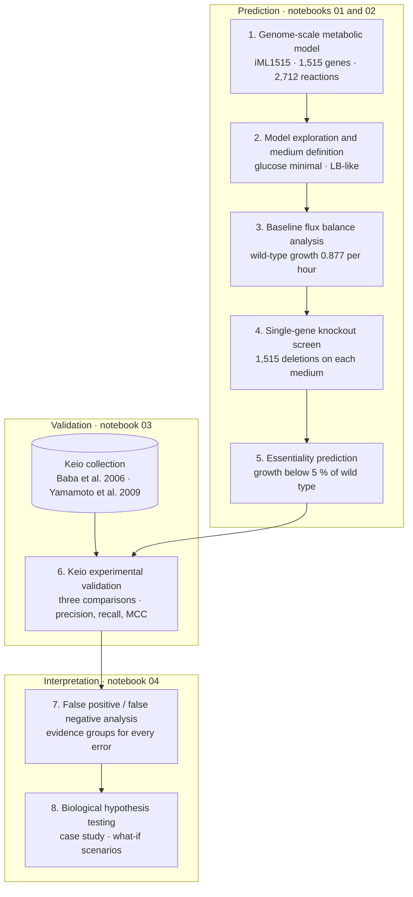
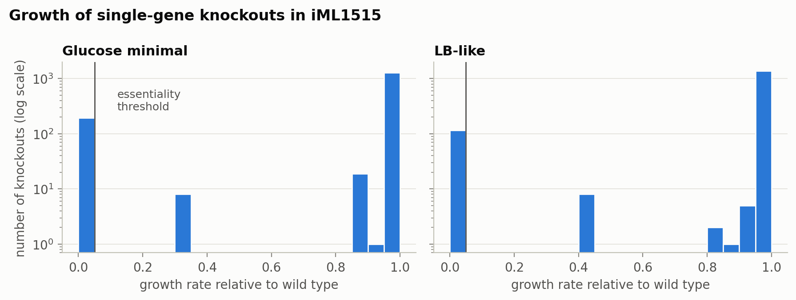
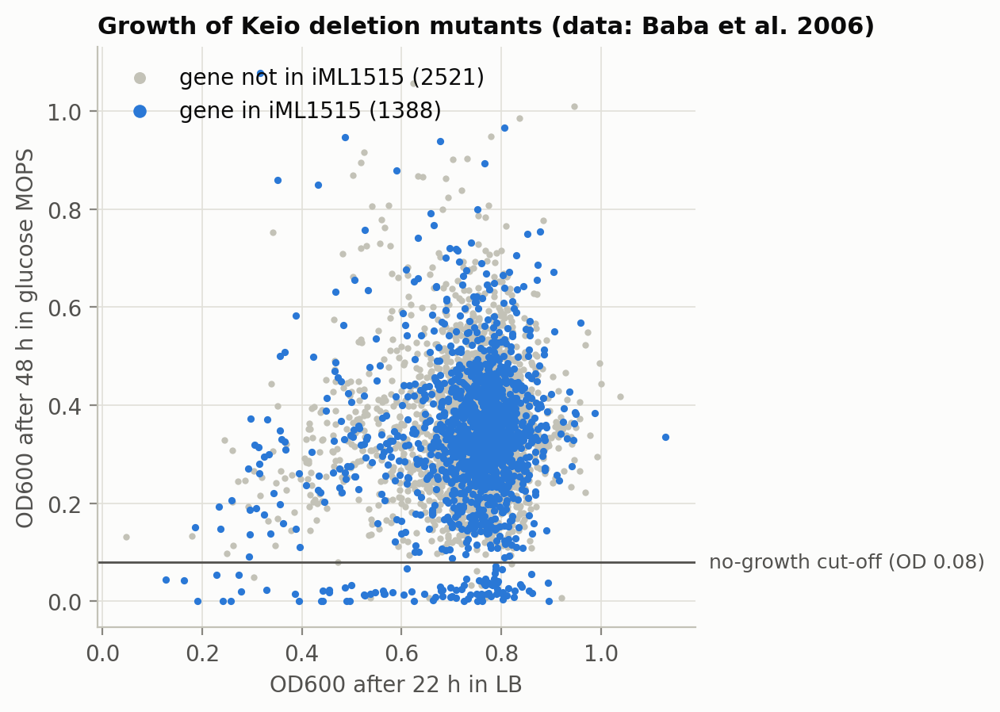
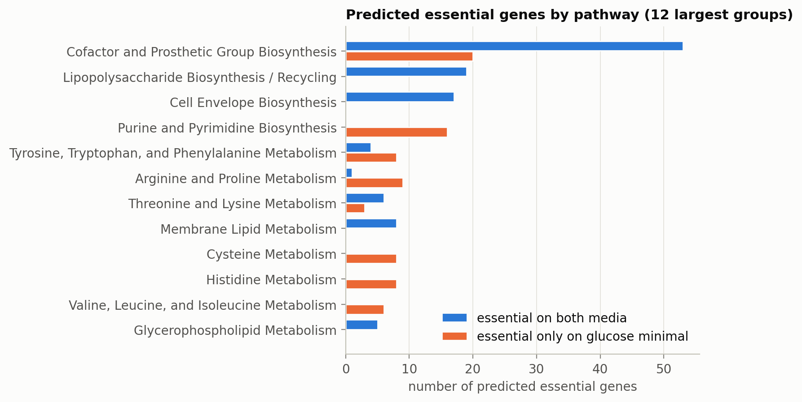
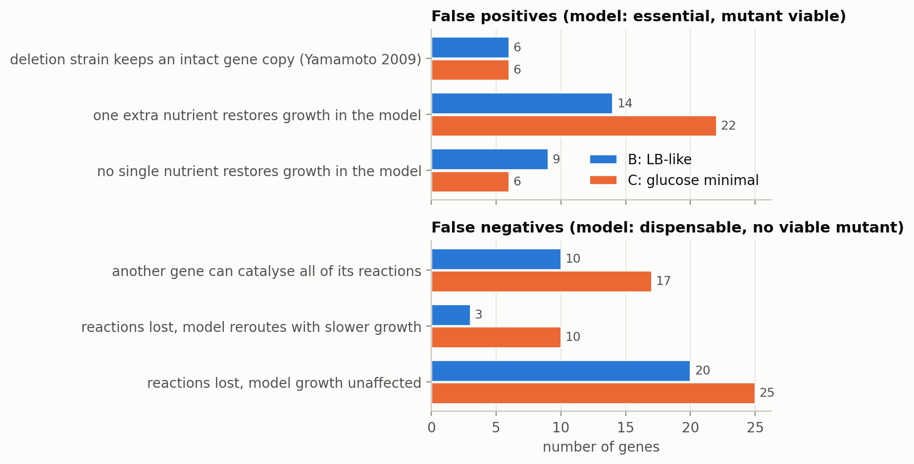

# Predicting Essential Genes in *E. coli* Using Genome-Scale Metabolic Modeling

**How accurately can a genome-scale metabolic model predict gene essentiality, and what can its prediction errors reveal about bacterial metabolism?**


This project deletes, one at a time, every metabolic gene of *Escherichia coli* K-12 in the genome-scale metabolic model **iML1515**, predicts with **flux balance analysis (FBA)** whether each knockout can still grow, and validates the predictions against the **Keio collection**, the experimental library of single-gene deletion mutants of *E. coli*.

The project does not stop at a score. Every gene for which model and experiment disagree is examined, sorted by the evidence available from the model and the experimental tables, and used to formulate biological hypotheses that are then tested in silico.

| | |
|---|---|
| **Organism** | *E. coli* K-12 (model: strain MG1655; mutants: strain BW25113) |
| **Model** | iML1515 (Monk et al. 2017), from BiGG Models |
| **Method** | Flux balance analysis and single-gene knockout screening with COBRApy |
| **Validation** | Keio collection (Baba et al. 2006), re-examined by Yamamoto et al. (2009) |
| **Analysis** | Matched-medium validation, false positive / false negative evidence groups, what-if scenarios |

## Contents

1. [At a glance](#at-a-glance)
2. [Key findings](#key-findings)
3. [Scientific workflow](#scientific-workflow)
4. [Biological background](#biological-background)
5. [Results](#results)
6. [Error analysis: what the mistakes reveal](#error-analysis-what-the-mistakes-reveal)
7. [What-if scenarios](#what-if-scenarios)
8. [Limitations](#limitations)
9. [Key takeaways](#key-takeaways)
10. [Reproducing the analysis](#reproducing-the-analysis)
11. [References](#references)

## At a glance

| | |
|---|---:|
| Metabolic genes in iML1515 (all screened)¹ | 1,515 |
| Reactions | 2,712 |
| Metabolites | 1,877 |
| Single-gene knockouts simulated per medium | 1,515 |
| Model genes with an experimental Keio label² | 1,508 |
| Genes predicted essential on LB-like medium | 116 |
| Genes predicted essential on glucose minimal medium | 195 |
| Wild-type growth rate predicted on glucose minimal medium | 0.877 h⁻¹ |

¹ The model file lists 1,516 gene entries. One of them, `s0001`, is a placeholder that iML1515 assigns to spontaneous reactions; it is not a real gene and is not screened.
² Seven model genes (*araA*, *araB*, *araD*, *rhaA*, *rhaB*, *rhaD*, *lacZ*) have no label because they are already deleted or disrupted in BW25113, the parent strain of the Keio collection.

## Key findings

The model's predictions were compared with three versions of the experimental labels. The positive class is "essential"; all comparisons score the same 1,508 genes.

| Comparison | Simulated medium | Experimental label | TP | FP | FN | Precision | Recall | MCC | Accuracy |
|---|---|---|--:|--:|--:|--:|--:|--:|--:|
| A: mismatched on purpose | glucose minimal | essential on LB | 89 | 106 | 31 | 0.46 | 0.74 | 0.54 | 0.91 |
| B: matched, rich | LB-like | essential on LB | 87 | 29 | 33 | 0.75 | 0.73 | 0.72 | 0.96 |
| **C: matched, minimal** | **glucose minimal** | **essential on LB, or mutant does not grow in glucose minimal medium** | **161** | **34** | **52** | **0.83** | **0.76** | **0.76** | **0.94** |

**Comparison C is the main result.** It is the comparison in which the simulated medium and the experimental medium agree best: both are defined, glucose-based minimal media. Comparison B is also matched, but its simulated medium is only an approximation of LB (see the note below). Comparison A is a deliberate negative control that shows what happens when the media do not match.

> **The LB-like medium is not LB.** LB (lysogeny broth) is made from tryptone and yeast extract and has no defined chemical composition. The "LB-like" medium in this project is glucose minimal medium plus the 65 compounds of a published in-silico LB definition (CarveMe media database; Machado et al. 2018), 62 of which iML1515 can take up. It is used only for yes/no growth calls; its predicted growth rate (18 h⁻¹) is not realistic, because every nutrient may be taken up at the same time.

What the analysis shows:

1. **The growth medium has to match.** Comparisons A and C use identical predictions and differ only in the label. Moving from A to C raises precision from 0.46 to 0.83: 72 of the 106 false positives in A are genes whose mutants do fail to grow in glucose minimal medium, so they were never model errors. Accuracy hardly registers the difference (0.91 against 0.94) because 86 to 92 % of the genes are non-essential either way; precision and MCC do.
2. **With matched media, the model agrees with the experiment for 94 to 96 % of genes**, with an MCC of 0.72 to 0.76. Recall stays around 0.75 (0.725 to 0.756) in all three comparisons: about a quarter of the experimentally essential genes are missed whatever the medium. The false negatives are a property of the network, not of the medium.
3. **Some "model errors" are doubtful labels.** For six false positives (*coaA*, *coaE*, *folP*, *glmM*, *hemE*, *lptB*), a later re-examination of the collection found that both isolates of the "deletion" strain still carry an intact copy of the gene (Yamamoto et al. 2009).
4. **Most remaining false positives are simple auxotrophs in the model.** In comparison C, 22 of 34 are rescued in the model by adding a single nutrient, for example thiamin for all eight thiamin biosynthesis genes and a sulfur compound for four sulfate assimilation genes.
5. **Most false negatives come from alternatives the model allows.** In comparison C, 17 of 52 have another gene listed for all of their reactions. For the other 35 the gene's reactions are lost, but the model either does not need them or routes flux around them (see the [*glyA* case study](#case-study-glya)).
6. **The calls are robust to the arbitrary choices.** The essentiality threshold (anything from 0.0001 % to 20 % of wild-type growth), the uptake limit of the LB nutrients (1 to 100 mmol/gDW/h) and the genetic background of the Keio parent strain change none of the essentiality calls.

## Scientific workflow



| Step | Notebook | Question answered |
|---|---|---|
| 1–3 | [`01_model_exploration`](notebooks/01_model_exploration.ipynb) | What does the model contain, and what growth does FBA predict? |
| 4–5 | [`02_knockout_screen`](notebooks/02_knockout_screen.ipynb) | Which genes does the model need, on which medium? |
| 6 | [`03_keio_validation`](notebooks/03_keio_validation.ipynb) | How well do the predictions agree with the experiment? |
| 7–8 | [`04_error_analysis`](notebooks/04_error_analysis.ipynb) | Why is the model wrong where it is wrong? |

## Biological background

**Genome-scale metabolic models.** A genome-scale metabolic model (GEM) is a curated list of the biochemical reactions an organism can carry out, assembled from its genome annotation and the biochemical literature. iML1515 describes *E. coli* K-12 MG1655 with 2,712 reactions that convert 1,877 metabolites (each metabolite is counted once per cellular compartment: cytoplasm, periplasm, extracellular space). Reactions are written as stoichiometric equations, for example `4 h_c + uppg3_c → 4 co2_c + cpppg3_c` for uroporphyrinogen decarboxylase in heme biosynthesis. A GEM covers metabolism only: 1,515 of the roughly 4,300 genes of *E. coli*.

**Gene-protein-reaction (GPR) rules.** Each enzymatic reaction carries a Boolean rule that says which genes are needed to catalyse it. These rules are what turns a gene deletion into a change in the network:

- **Enzyme complexes** are written with `and`: all subunits are required. The glycine cleavage system needs `gcvH and gcvP and lpd and gcvT`; deleting any one of them removes the reaction.
- **Isoenzymes** are written with `or`: any one gene is enough. Aspartate kinase is `thrA or metL or lysC`; deleting one of them leaves the reaction available in the model.

In iML1515, 313 reactions have a rule containing `and`, 743 a rule containing `or`, and 446 have no gene at all (mostly the 337 exchange, demand and sink reactions at the model boundary, plus transport steps and reactions without an assigned enzyme). The way a model treats isoenzymes turns out to explain many of its false negatives.

**Exchange reactions and growth media.** The model exchanges metabolites with its environment through *exchange reactions*. Opening an exchange reaction for uptake, with a maximum rate in mmol per gram dry weight per hour (mmol/gDW/h), puts that compound in the medium. The default iML1515 medium opens 24 exchanges: glucose (10 mmol/gDW/h), oxygen, ammonium, phosphate, sulfate and trace elements. The LB-like medium opens 66. Because the medium decides which compounds the cell must make itself, it decides which genes are essential.

**Flux balance analysis and the steady-state assumption.** FBA assumes that the cell is at a **steady state**: every internal metabolite is produced exactly as fast as it is consumed, so concentrations do not change. With the stoichiometric matrix *S* and the vector of reaction rates (fluxes) *v*, FBA solves a linear program:

$$
\max_{v}\; v_{\text{biomass}} \quad \text{subject to} \quad S\,v = 0, \qquad v_{\min} \le v \le v_{\max}
$$

The bounds encode reversibility, nutrient availability and deleted genes (Orth et al. 2010). FBA needs no kinetic parameters, which is why it scales to genome size, but this also means that gene expression, enzyme amounts, enzyme kinetics and regulation do not enter the calculation directly. A reaction is either available up to its bounds or blocked.

**The biomass reaction.** The objective is a pseudo-reaction that consumes all cell components (amino acids, nucleotides, lipids, cofactors, cell-wall precursors, ions) in the proportions found in an *E. coli* cell. Its maximal flux is read as the growth rate. If a knockout makes even one biomass component impossible to produce, the predicted growth is zero.

**Gene essentiality.** A gene is essential under a given condition when the cell cannot grow without it. In this project a knockout is called essential when its predicted growth rate is below 5 % of the wild type on the same medium. Experimentally, the Keio collection calls a gene an essential-gene candidate when no deletion mutant could be isolated on LB agar (Baba et al. 2006).

**Auxotrophy.** An auxotroph is a mutant that needs a nutrient the wild type can make itself, for example a mutant that can no longer synthesise an amino acid and must take it up from the medium. Auxotrophic genes are essential on minimal medium and dispensable on rich medium. They are the reason why the medium of the prediction has to match the medium of the experiment.

## Results

### 1. Most gene knockouts either kill the model or have no effect



- **What it shows.** The predicted growth rate of each of the 1,515 knockouts, relative to the wild type on the same medium, for glucose minimal medium (left) and LB-like medium (right). The vertical line is the 5 % essentiality threshold.
- **How to read it.** The y-axis is logarithmic, so the large bars at 1.0 and the smaller ones at 0 are both visible. On glucose minimal and LB-like medium, 1,272 and 1,356 knockouts keep at least 99 % of wild-type growth, 195 and 116 fall below the threshold, and only 48 and 43 lie in between.
- **Biological meaning.** In FBA a deletion either blocks the production of a biomass component (growth 0) or the network has an equivalent alternative such as an isoenzyme or a parallel pathway (growth 1). Intermediate values mean the model can reroute flux at a lower yield. The cluster near 0.32 on glucose minimal medium is the eight ATP synthase subunits (*atpA* to *atpH*): without oxidative phosphorylation the model must make ATP less efficiently.
- **Key takeaway.** Because almost no knockout sits near the threshold, the essentiality calls do not depend on it: any threshold from 0.000001 to 0.2 gives the same 195 and 116 essential genes (`results/tables/threshold_sensitivity.csv`).

### 2. Experimental essentiality also depends on the medium



- **What it shows.** Each point is one Keio deletion mutant: its optical density at 600 nm (OD600, a standard proxy for cell density) after 22 h in LB (x-axis) and after 48 h in glucose MOPS minimal medium (y-axis). Blue points are genes in iML1515 (1,388), grey points other genes (2,521). Data: Baba et al. (2006).
- **How to read it.** Most mutants grow in both media and form the central cloud. The horizontal line is the **no-growth threshold** of OD600 0.08, the cut-off used in Table III of the paper (mean minus two standard deviations of all mutants). Mutants below it grow in LB but not in minimal medium. Genes for which no mutant could be obtained at all are, by definition, not in the plot.
- **Biological meaning.** The mutants under the line are auxotrophs: they lack a biosynthetic function whose product LB supplies. There are 103 such genes, 93 of them in iML1515. They are the difference between the LB label (120 essential model genes) and the glucose minimal label (213).
- **Key takeaway.** Experimental essentiality is condition-dependent in the same way as the model's, so a fair test must compare prediction and experiment on the same medium.

### 3. Matching the medium changes the picture more than any model parameter


- **What it shows.** Three metrics for each comparison. **Precision** = TP / (TP + FP): of the genes the model calls essential, the fraction that is essential in the experiment. **Recall** = TP / (TP + FN): of the experimentally essential genes, the fraction the model finds. The **Matthews correlation coefficient (MCC)** uses all four cells of the confusion matrix, ranges from −1 to 1 (0 = no better than chance) and stays informative when one class is rare.
- **How to read it.** Grey is comparison A, blue B, orange C. Recall is almost flat; precision and MCC carry the difference.
- **Biological meaning.** Comparison A is mismatched on purpose: it scores minimal-medium predictions against rich-medium labels, so every amino acid, nucleotide or vitamin biosynthesis gene the model correctly needs on glucose counts as a false positive. Only 8 % (LB label) to 14 % (glucose label) of the genes are essential, so a model that called every gene non-essential would already reach an accuracy of 86 to 92 %. That is why accuracy is reported but never used alone.
- **Key takeaway.** Once the media match (C), precision rises to 0.83 and MCC to 0.76. The recall of about 0.75 is the model's real ceiling, and the error analysis below explains much of it.

Recall in B is exactly 0.725 (87 of 120); the figure prints it as 0.72 and the table above as 0.73 because of rounding. All unrounded values are in `results/tables/metrics.csv`.

For orientation only: Bernstein et al. (2023) cite an overall accuracy of 93.4 % for iML1515 from the original model publication, measured on Keio mutants across 16 carbon sources. That number comes from a different data set and is not directly comparable with the table above.

### 4. Minimal medium makes biosynthesis essential



- **What it shows.** The pathways (model subsystems) of the predicted essential genes, split into genes essential on both media (116, blue) and genes essential only on glucose minimal medium (79, orange). No gene is essential only on the LB-like medium. The 12 largest pathways are shown; a gene with reactions in several pathways is counted once in each.
- **How to read it.** Orange bars without a blue partner are pathways that become essential only when the medium lacks their end product.
- **Biological meaning.** The minimal-only genes are concentrated in the synthesis of building blocks: purine and pyrimidine biosynthesis (16), arginine and proline (9), aromatic amino acids (8), cysteine (8), histidine (8), branched-chain amino acids (6) and cofactors (20). On glucose minimal medium the cell must make all of these from glucose, ammonium and salts; the LB-like medium supplies them. The genes essential on both media are dominated by cofactor biosynthesis (53), lipopolysaccharide (19), cell envelope (17) and membrane lipid (8) synthesis: functions for which none of the LB-like nutrients offers a bypass in the model. Envelope components such as lipopolysaccharide cannot be taken up from the medium at all.
- **Key takeaway.** The medium shifts essentiality from the synthesis of building blocks to a core of non-replaceable functions, in both the model and the experiment.

## Error analysis: what the mistakes reveal

A misprediction can reflect a gap or simplification in the model, a mismatch between the simulated and the real conditions, or a doubtful experimental label. To tell these apart, each mispredicted gene was assigned to an **evidence group** based on what the model and the experimental tables show. A group describes the evidence; it is not a verdict on the biological cause. The explanations below are **hypotheses** supported by the model and by the literature, not experimentally confirmed mechanisms.



The figure counts the genes in each evidence group, for comparison B (blue) and comparison C (orange). The upper panel shows false positives, the lower panel false negatives. The rest of this section follows comparison C (34 false positives, 52 false negatives); per-gene evidence for both comparisons is in `results/tables/errors_glucose.csv` and `errors_lb.csv`.

### False positives: the model says essential, the mutant is viable

| Evidence group | Genes | Examples |
|---|--:|---|
| Deletion strain keeps an intact gene copy | 6 | *coaA*, *coaE*, *folP*, *glmM*, *hemE*, *lptB* |
| One extra nutrient restores growth in the model | 22 | *thiC–thiS* (thiamin), *cysC*, *cysD*, *cysN*, *cysQ* (sulfur compounds), *nadB*, *nadC* (nicotinate), *pdxJ* (vitamin B6), *bioA*, *fabH* (biotin), *pabA*, *pabB*, *aroD*, *pheA*, *dapF* |
| No single nutrient restores growth in the model | 6 | *folB*, *kdsC*, *luxS*, *mtn*, *yrbG*, *zupT* |

The groups are assigned in this order of precedence: a doubtful label first, then a model rescue.

**Doubtful labels.** Yamamoto et al. (2009) re-examined both independent isolates of every Keio mutant by PCR and found 25 genes for which both isolates still carry an intact copy of the "deleted" gene, a partial duplication. Six of these genes are false positives here. For them the existence of a mutant does not show that the gene is dispensable, and Yamamoto et al. list them as candidate essential genes. The model may well be right. Their labels were deliberately left unchanged, so that the scores are not adjusted after looking at the errors.

**Thiamin.** All eight thiamin biosynthesis genes (*thiC*, *thiD*, *thiE*, *thiF*, *thiG*, *thiH*, *thiI*, *thiS*) are false positives. Their mutants grow in glucose MOPS medium (OD600 0.18 to 0.44 after 48 h), while without them the model cannot make thiamine diphosphate, a biomass component; thiamin alone rescues each knockout in the model. Bernstein et al. (2023) observed the same class of errors for vitamin and cofactor genes in pooled mutant fitness data and proposed two explanations: carry-over of vitamins within individual mutant cells, or cross-feeding between mutants. The Keio data alone cannot tell whether thiamin or a precursor was available to the cells.

**Sulfate assimilation.** Four genes of the sulfate assimilation pathway (*cysC*, *cysD*, *cysN*, *cysQ*) are false positives. In the model, any of ten sulfur compounds rescues them, among them sulfonates such as taurine, as well as cysteine and glutathione. The experimental medium is buffered with MOPS (3-(N-morpholino)propanesulfonic acid), itself a sulfonate, which Orth & Palsson (2012) note as a potential alternative sulfur source. MOPS is not in the model, so this hypothesis was tested with taurine as a stand-in (scenario C2). Two observations argue for caution: the *cysC*, *cysD* and *cysN* mutants grow only weakly (OD600 0.12 to 0.16 after 48 h, close to the 0.08 cut-off; *cysC* is below it at 24 h), and the *cysH* mutant does not grow (OD600 0.026 after 48 h), although a sulfonate bypasses *cysH* in the model as well.

**Biotin and the *bioA* exception.** Of the six biotin biosynthesis genes, only *bioA* is a false positive. The *bioB*, *bioC*, *bioD*, *bioF* and *bioH* mutants do not grow in glucose MOPS medium (OD600 0.035 to 0.065 after 48 h) and are predicted correctly. Supplying biotin in the model (scenario C1) fixes *bioA* but turns the other five into new errors, so biotin was evidently not available to the mutants in the experiment. The exception is *bioA* itself, whose growth is borderline: OD600 0.109 after 48 h, just above the cut-off.

**No single nutrient rescues.** For six genes the model has no way around the deletion, yet the cell apparently does. These are candidates for gaps in the reconstruction, such as a missing isoenzyme or pathway or an incorrect gene rule. Confirming that would require gene-by-gene literature curation, which this project did not do.

### False negatives: the model says dispensable, no viable mutant exists

| Evidence group | Genes | Examples |
|---|--:|---|
| Another gene can catalyse all of its reactions | 17 | *metE* (backup: *metH*), *thrA* and *metL* (each other and *lysC*), *leuB* (*dmlA*), *ilvA* (*tdcB*), *folA* (*folM*), *pyrH* (*cmk*) |
| Reactions lost, model growth unaffected | 25 | *carA*, *carB*, *pyrD*, *nrdA*, *nrdB*, *plsB*, *pgsA*, *lnt*, *spoT* |
| Reactions lost, model reroutes with slower growth | 10 | *glyA*, *serA*, *serB*, *serC*, *gapA*, *pgk*, *eno*, *folD*, *atpB*, *atpC* |

**Isoenzymes the cell may not be able to use.** For 17 genes, the gene rules list another gene for every reaction, so the deletion blocks nothing in the model. A clear example is *metE*. The final step of methionine synthesis is catalysed in the model by `metH or metE`. MetH, however, depends on vitamin B12 (cobalamin), which *E. coli* cannot synthesise de novo and which glucose minimal medium does not contain. The gene rule does not encode this cofactor requirement. In the experiment the *metE* mutant does not grow (OD600 0.009) while the *metH* mutant does (0.509). For *thrA* and *metL*, the three aspartate kinases (*thrA*, *metL*, *lysC*) are interchangeable in the model, whereas in the cell each is controlled by a different end product (threonine, methionine, lysine). Gene expression, enzyme amounts and regulation are exactly what FBA leaves out.

**Functions outside the model's objective.** For 25 genes the reactions are lost but predicted growth is essentially unchanged (at least 99 % of wild type). Some of these genes are essential for reasons FBA cannot represent. *spoT* is an example: SpoT is the main hydrolase of the alarmone (p)ppGpp, and *spoT* deletions are lethal in *relA*⁺ strains (Xiao et al. 1991), a regulatory effect, not a missing biomass component.

**Rerouting.** For 10 genes the model finds a detour at a cost. The serine genes *serA*, *serB* and *serC* are an instructive case: Bernstein et al. (2023) traced their misprediction to the reaction GHMT2r running backwards, so that the model makes serine from glycine (tested in scenario C3).

#### Case study: *glyA*

*glyA* (b2551) encodes serine hydroxymethyltransferase, which converts serine and tetrahydrofolate into glycine and 5,10-methylene-tetrahydrofolate, the main source of glycine and one-carbon units in *E. coli*.

- **In the model**, the *glyA* knockout keeps 98.7 % of wild-type growth on glucose minimal medium (growth ratio 0.987). Two reactions are lost (GHMT2r and THFAT); the other reactions of GlyA are also catalysed by LtaE according to their gene rules.
- **In the experiment**, the *glyA* mutant grows in LB but not in glucose MOPS medium (OD600 0.009 after 48 h).

Notebook 04 asks which alternative the model relies on by deleting *glyA* and additionally blocking candidate routes:

| Simulation (glucose minimal medium) | Growth relative to wild type |
|---|--:|
| *glyA* deleted | 0.987 |
| + threonine aldolase blocked (THRA, THRA2; gene rule *glyA* or *ltaE*) | 0.987 |
| + threonine dehydrogenase blocked (THRD, first step of the Tdh–Kbl route) | 0.987 |
| + both threonine routes blocked | 0 |

The model makes glycine from threonine, through either of two routes, and only fails when both are blocked. The cell evidently could not rely on these routes in glucose minimal medium. Possible reasons are insufficient enzyme capacity, low expression of the alternative enzymes under these conditions, or metabolic regulation. All of them are outside what FBA represents. This is a hypothesis that the model generates but cannot test; it would need, for example, expression data or growth of the mutant with added glycine.

## What-if scenarios

Each scenario changes one assumption suggested by the literature or by the evidence above, reruns the full knockout screen and rescores **all** genes, not only the errors it was meant to explain. The scenarios are in-silico tests of hypotheses, **not corrected models**: the baseline results above remain the results of this project.

| Scenario | Hypothesis tested | FP | FN | MCC | Errors resolved | New errors |
|---|---|--:|--:|--:|--:|--:|
| C baseline (glucose minimal) | | 34 | 52 | 0.757 | | |
| C1: add thiamin, biotin, nicotinate and pantothenate | vitamins were available to the mutants (carry-over or cross-feeding) | 22 | 65 | 0.746 | 12 | 13 |
| C2: add taurine as a sulfur source | MOPS buffer served as an alternative sulfur source | 30 | 53 | 0.764 | 4 | 1 |
| C3: make GHMT2r irreversible | serine is not made from glycine in vivo | 34 | 49 | 0.767 | 3 | 0 |
| B baseline (LB-like) | | 29 | 33 | 0.715 | | |
| B1: add biotin and L-glutamine to LB-like medium | real LB supplies both; the in-silico LB list lacks them | 21 | 36 | 0.728 | 8 | 3 |

**C1: vitamins.** Resolves 12 errors (the eight thiamin genes, *nadB*, *nadC*, *bioA*, *fabH*) and creates 13 new false negatives: *bioB*, *bioC*, *bioD*, *bioF*, *bioH* (biotin), *panB*, *panC*, *panD* (pantothenate), *nadA* (nicotinate), *fabB*, *fabI*, *fabZ* and *iscS*. The vitamins do not behave alike: the thiamin genes are consistent with thiamin availability, while the non-growing biotin, pantothenate and *nadA* mutants argue against a general supply of these compounds. The three *fab* genes are a model-structure effect. *E. coli* builds the pimelate moiety of biotin with its fatty acid synthesis enzymes (Lin et al. 2010). In the model these genes are essential only through biotin synthesis (they also become non-essential in B1, where biotin is the shared addition), whereas in the cell they are also needed for membrane fatty acids: Keio obtained no deletion mutant for any of them, even on LB. MCC falls slightly (0.757 → 0.746): higher precision is paid for with lower recall.

**C2: a sulfonate as sulfur source.** Resolves the four sulfate assimilation genes and creates one new error, *cysH*, whose mutant does not grow although taurine bypasses it in the model. MCC rises slightly (0.764). The *cysH* result means that a sulfonate supply alone does not explain the pattern.

**C3: GHMT2r irreversible.** Resolves *serA*, *serB* and *serC* without creating any new error; MCC rises to 0.767. This reproduces the observation of Bernstein et al. (2023) on independent data. It does not affect *glyA*, whose knockout removes GHMT2r anyway.

**B1: completing the LB-like medium.** The published in-silico LB list contains no biotin, L-glutamine or L-asparagine. Adding biotin and glutamine resolves the six biotin genes, *fabH* and *glnA*, and creates the same three *fab* false negatives as C1. Whether real LB supplies enough of each compound is an assumption, not a measurement.

Why not adopt the best scenario? A scenario that resolves errors can create others, and choosing assumptions after looking at the errors would inflate the score. Each scenario is reported next to the baseline so that its full effect is visible. Full gene lists are in `results/tables/scenarios.csv`.

## Limitations

These limitations define the scope of the conclusions; most are inherent to constraint-based modeling.

- **Classical FBA assumes a steady state and an optimal cell.** It predicts the maximal biomass production allowed by stoichiometry, not the growth rate a real mutant achieves. FBA growth rates are predictions, not measurements.
- **Gene expression is not modeled.** A reaction counts as available whenever its gene rule is satisfied, even if the genes are not expressed under the conditions of the experiment.
- **Enzyme abundance and enzyme kinetics are not modeled.** An alternative enzyme with a fraction of the activity of the deleted one can carry any flux up to the reaction bounds.
- **Thermodynamic and regulatory constraints are simplified or absent.** Reversibility is set per reaction, which is how a reaction such as GHMT2r can run in a physiologically unlikely direction. Regulation, toxic intermediates and alarmones such as (p)ppGpp are absent.
- **Different strains.** iML1515 represents *E. coli* K-12 MG1655, whereas the Keio collection was built in BW25113. Deleting the seven genes known to be missing in BW25113 changes no essentiality call, but other strain differences are not represented.
- **The LB-like medium is an approximation** of a chemically undefined medium. Three of its 65 compounds have no exchange reaction in iML1515, and the list lacks biotin, L-glutamine and L-asparagine.
- **MOPS is part of the experimental minimal medium but is not represented in the model.** Its possible role as a sulfur source could only be approximated with taurine.
- **iML1515 covers metabolic genes, not the whole genome.** Essential genes of replication, transcription and translation are outside the model and outside this comparison.
- **Experimental essentiality labels can contain technical errors.** "No deletion mutant obtained" is not the same as "essential": a deletion can fail for technical reasons, and an obtained mutant can carry a duplication or a suppressor mutation, as the Yamamoto et al. (2009) re-examination shows. The no-growth cut-off (OD600 0.08 at 48 h) is taken from the paper but is still a choice; between 0.04 and 0.15, or with the 24 h reading, the MCC of comparison C ranges from 0.70 to 0.77 (`results/tables/mops_cutoff_sensitivity.csv`).
- **A computational nutrient rescue does not prove that the nutrient was available or used in the experiment.** It shows what a knockout is missing in the model, nothing more.

## Key takeaways

- A genome-scale metabolic model predicts gene essentiality well, MCC 0.76 for *E. coli* on glucose minimal medium, **provided that prediction and experiment refer to the same growth medium**. Without that match, the same predictions look much worse (MCC 0.54).
- Accuracy is a poor guide when essential genes are a minority (8 to 14 % here). Precision, recall and MCC show differences that accuracy hides.
- False positives often point to the experiment rather than the model: doubtful labels, borderline growth, and nutrients that may have reached the cells (thiamin, possibly MOPS-derived sulfur).
- False negatives point to what FBA leaves out: isoenzymes that are present in the gene rules but not usable in the cell, routes that are stoichiometrically possible but apparently not physiologically sufficient (*glyA*), questionable reaction directions (GHMT2r), and essential functions outside metabolism (*spoT*).
- In-silico scenarios are useful for testing such hypotheses, but each fix has side effects on other genes; reporting them next to an unchanged baseline keeps the evaluation honest.

<!-- What I learned: reserved for the author. -->

## Reproducing the analysis

### Repository structure

```
ecoli-fba/
├── notebooks/                       run in this order
│   ├── 01_model_exploration.ipynb   the model, its medium, a first FBA
│   ├── 02_knockout_screen.ipynb     knockout screen on two media, threshold and uptake sensitivity
│   ├── 03_keio_validation.ipynb     Keio labels, the three comparisons, robustness checks
│   └── 04_error_analysis.ipynb      evidence for every error, glyA case study, scenarios
├── src/ecoli_fba/                   reusable analysis code used by the notebooks
│   ├── model.py                     load iML1515 (downloads it on first use)
│   ├── media.py                     glucose minimal and LB-like media
│   ├── knockout.py                  single-gene knockout screen, essentiality calls
│   ├── keio.py                      parse the Keio tables, build experimental labels
│   ├── evaluate.py                  confusion matrix, precision, recall, MCC
│   ├── annotation.py                gene names, pathways, GPR structure, backup genes
│   ├── errors.py                    blocked biomass precursors, nutrient rescue, evidence groups
│   └── plotting.py                  shared figure style
├── scripts/fetch_keio.py            download the Keio tables and verify their checksums
├── tests/                           pytest suite (toy model, parser contracts, metrics)
├── data/                            downloaded inputs, not committed; see data/README.md
└── results/
    ├── tables/                      every number quoted in this README; see results/README.md
    └── figures/                     the figures shown above
```

### Setup

Python 3.10 or newer. With a virtual environment:

```bash
git clone https://github.com/ardaqas/ecoli-fba.git
cd ecoli-fba
python -m venv .venv
source .venv/bin/activate
pip install -r requirements.txt      # installs the package in editable mode plus pytest and JupyterLab
```

Or with conda:

```bash
conda env create -f environment.yml
conda activate ecoli-fba
```

The package must be installed in editable mode (`-e .`, as both files do), because the code locates `data/` and `results/` relative to the repository.

### Data

- **iML1515** is downloaded from BiGG Models on first use (by notebook 01 or `ecoli_fba.model.load_model()`); internet access is needed once.
- **Keio tables** are downloaded and checksum-verified with:

  ```bash
  python scripts/fetch_keio.py         # about 6 minutes; Europe PMC serves the 2006 archive slowly
  ```

The raw data are not committed. Sources, checksums and the label definitions are documented in [`data/README.md`](data/README.md).

### Running the notebooks

```bash
jupyter lab                          # then run notebooks 01 to 04 in order
```

| Notebook | Needs | Runtime (laptop) | Writes |
|---|---|---|---|
| 01 | internet on first run | < 1 min | nothing |
| 02 | model | about 2 min | knockout tables, 2 figures |
| 03 | Keio tables, output of 02 | about 1 min | metrics, comparison tables, 2 figures |
| 04 | Keio tables, output of 03 | 6 to 7 min | error tables, scenarios, 1 figure |

To run a notebook without opening JupyterLab, from the repository root:

```bash
jupyter nbconvert --to notebook --execute --inplace notebooks/02_knockout_screen.ipynb
```

Every output file is described in [`results/README.md`](results/README.md). With the software versions listed below, rerunning notebooks 01 to 04 from a clean copy reproduced all 13 tables and 5 figures byte for byte. Other solver or library versions may change the last digits of growth rates.

### Tests

```bash
pytest            # 42 tests, a few seconds; 4 of them are skipped until the Keio tables are downloaded
pytest -m slow    # full-model knockout screen, about 20 seconds (needs data/iML1515.json)
```

The unit tests use a seven-gene toy model whose essential genes can be worked out by hand, check the metrics against hand calculations and scikit-learn, and test the Keio parser on synthetic tables built at test time. Four further tests run on the real Keio files and check the parser against the numbers stated in the paper (4,288 targeted ORFs, 3,985 mutants, 303 essential-gene candidates identical to the paper's own list, 25 duplications reported by Yamamoto et al. 2009); they are skipped until `scripts/fetch_keio.py` has been run.

### Software versions used for the published results

Python 3.10.11, COBRApy 0.32.1 with the GLPK solver, pandas 2.3.3, NumPy 2.2.6, matplotlib 3.10.9, scikit-learn 1.7.2, xlrd 2.0.2.

## Data sources and licensing

- iML1515: BiGG Models (https://bigg.ucsd.edu), Monk et al. (2017).
- In-silico LB composition: CarveMe media database (Machado et al. 2018), Apache-2.0; the compound list is reproduced in `src/ecoli_fba/media.py`.
- Keio collection tables: supplementary material of Baba et al. (2006) and Yamamoto et al. (2009). They are downloaded by the user and not redistributed here, because the 2006 article carries a publisher copyright notice and no open licence statement.

## References

- Baba T., Ara T., Hasegawa M., et al. (2006) Construction of *Escherichia coli* K-12 in-frame, single-gene knockout mutants: the Keio collection. *Mol Syst Biol* 2:2006.0008. https://doi.org/10.1038/msb4100050
- Bernstein D.B., Akkas B., Price M.N., Arkin A.P. (2023) Evaluating *E. coli* genome-scale metabolic model accuracy with high-throughput mutant fitness data. *Mol Syst Biol* 19:e11566. https://doi.org/10.15252/msb.202311566
- Ebrahim A., Lerman J.A., Palsson B.Ø., Hyduke D.R. (2013) COBRApy: COnstraints-Based Reconstruction and Analysis for Python. *BMC Syst Biol* 7:74. https://doi.org/10.1186/1752-0509-7-74
- Lin S., Hanson R.E., Cronan J.E. (2010) Biotin synthesis begins by hijacking the fatty acid synthetic pathway. *Nat Chem Biol* 6:682–688. https://doi.org/10.1038/nchembio.420
- Machado D., Andrejev S., Tramontano M., Patil K.R. (2018) Fast automated reconstruction of genome-scale metabolic models for microbial species and communities. *Nucleic Acids Res* 46:7542–7553. https://doi.org/10.1093/nar/gky537
- Monk J.M., Lloyd C.J., Brunk E., et al. (2017) iML1515, a knowledgebase that computes *Escherichia coli* traits. *Nat Biotechnol* 35:904–908. https://doi.org/10.1038/nbt.3956
- Orth J.D., Palsson B.Ø. (2012) Gap-filling analysis of the iJO1366 *Escherichia coli* metabolic network reconstruction for discovery of metabolic functions. *BMC Syst Biol* 6:30. https://doi.org/10.1186/1752-0509-6-30
- Orth J.D., Thiele I., Palsson B.Ø. (2010) What is flux balance analysis? *Nat Biotechnol* 28:245–248. https://doi.org/10.1038/nbt.1614
- Xiao H., Kalman M., Ikehara K., et al. (1991) Residual guanosine 3′,5′-bispyrophosphate synthetic activity of *relA* null mutants can be eliminated by *spoT* null mutations. *J Biol Chem* 266:5980–5990. https://doi.org/10.1016/S0021-9258(19)67694-5
- Yamamoto N., Nakahigashi K., Nakamichi T., et al. (2009) Update on the Keio collection of *Escherichia coli* single-gene deletion mutants. *Mol Syst Biol* 5:335. https://doi.org/10.1038/msb.2009.92
